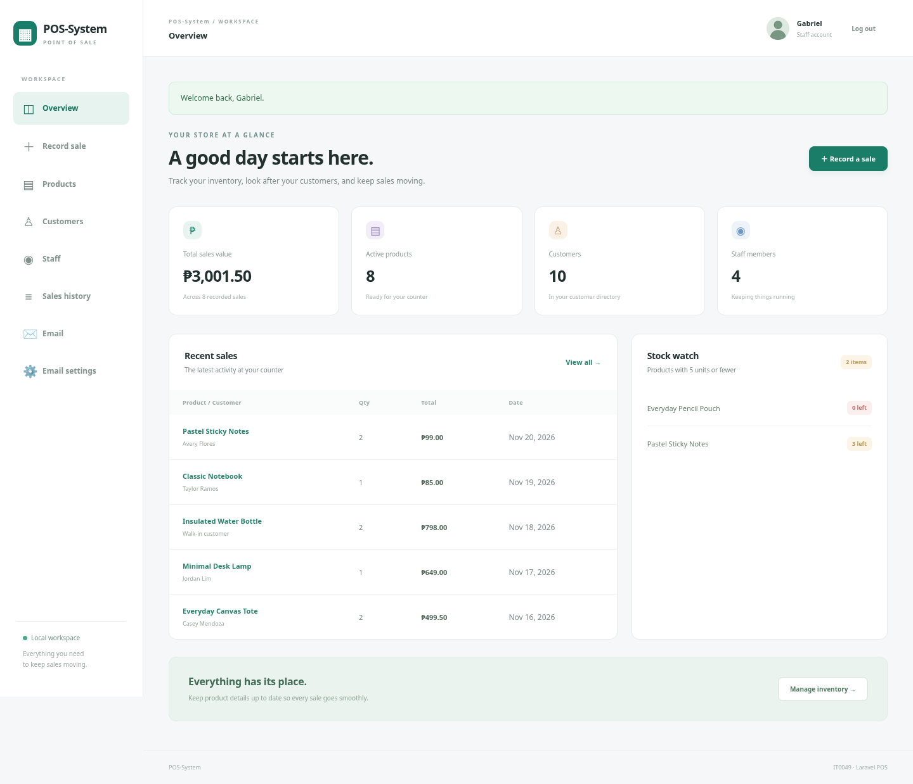

# POS-System — Laravel version

The Laravel conversion of POS-System, preserving the products, customers, staff accounts, inventory-aware sales, private image uploads, dashboard, sales history, receipts, and sample dataset from the CodeIgniter version.

## Run in VS Code

1. Extract the ZIP into a **new folder** and open **POS-System** in VS Code. The project root contains `artisan`, `setup.php`, and `composer.json`. Keep your earlier CodeIgniter folder separately.
2. Use **PHP 8.2+** and **Composer 2**. Your XAMPP PHP 8.2.12 is compatible. Restart VS Code if you recently installed these tools or changed PATH.
3. Open **Terminal → New Terminal** in the project root, then run:

```sh
php setup.php
php artisan serve
```

4. Open **http://127.0.0.1:8000**. Sign in with **Gabriel** / **Admin123!**.

On Windows, you can also run **START-WINDOWS.bat** after installing PHP and Composer. Keep the server terminal open; Ctrl+C stops it. There is no frontend build step: CSS, JavaScript, and sample images are included locally. Node.js, npm, Apache, and a MySQL server are not required for the default SQLite setup. Composer needs an internet connection on the first setup.

Setup creates `.env`, generates a unique application key, creates the SQLite database, runs migrations, and loads samples. Re-running it preserves the key and existing records and skips duplicate sample seeding. Do not run `migrate:fresh` on records you want to keep.

### XAMPP extension check

This Laravel version needs **Ctype, cURL, DOM, Fileinfo, GD, Mbstring, OpenSSL, PDO, PDO_SQLite, Session, Tokenizer, and XML**. Many are built into PHP. Composer also needs ZIP or an unzip utility for convenient archive extraction. Setup lists every missing required extension at once.

Run these in PowerShell:

```powershell
php --ini
php -m | Select-String 'gd|pdo_sqlite|mbstring|fileinfo|curl'
```

For the XAMPP installation used with the earlier project, open:

```powershell
code C:\xampp\php\php.ini
```

Remove leading semicolons from needed extension lines, including:

```ini
extension=gd
extension=pdo_sqlite
extension=mbstring
extension=fileinfo
extension=curl
```

Save and retry `php setup.php`. Enable existing lines rather than adding duplicate entries. GD prepares product images and avatars; **PDO_SQLite** provides Laravel's database driver. Enabling only SQLite3 does not enable PDO_SQLite.

## Sample records and logins

First-time setup loads **8 products with images, 10 customers, 4 staff accounts with avatars, and 8 sales totaling ₱3,001.50**. Inventory already reflects the sample sales.

| Username | Password | Full name |
| --- | --- | --- |
| Gabriel | Admin123! | Gabriel |
| Kenneth | Cashier123! | Kenneth |
| Mendoza | Trainee123! | Mendoza |
| Catangay | Catangay123! | Catangay |

All accounts have the same staff permissions, matching the original application's access rules. Usernames identify accounts; separate admin/cashier roles are not implemented.

| Product | Price | Remaining stock |
| --- | --- | --- |
| Classic Notebook | ₱85.00 | 47 |
| Gel Pen Set | ₱125.50 | 96 |
| Ceramic Coffee Mug | ₱199.00 | 23 |
| Everyday Canvas Tote | ₱249.75 | 18 |
| Minimal Desk Lamp | ₱649.00 | 9 |
| Insulated Water Bottle | ₱399.00 | 16 |
| Pastel Sticky Notes | ₱49.50 | 3 |
| Everyday Pencil Pouch | ₱159.00 | 0 |

This is a separate Laravel installation with the same samples. It does not import records you subsequently added to your local CodeIgniter database. Do not replace the Laravel database with the CodeIgniter database: their framework tables and timestamp conventions differ.



## Features

- Staff login/logout with Laravel authentication, session regeneration, hashed passwords, rate limiting, and CSRF-protected forms.
- Dashboard with revenue, counts, recent sales, and low-stock alerts.
- Products: search, pagination, creation/editing, prepared image upload, archive and restore.
- Customers: complete CRUD with validated name, email, and phone fields.
- Staff: complete CRUD with unique username, confirmed password, and prepared avatar upload. Blank passwords on edit preserve the existing hash.
- Record Sale: one product per sale, an optional customer, a quantity, and automatic attribution to the signed-in staff member.
- Sales history and printable receipts with product, customer/walk-in label, staff, quantity, total, and date.
- Atomic stock deduction and sale recording. Overselling and invalid references roll back without reducing stock.
- Duplicate submission protection using a unique request key. Server calculations ignore submitted prices, totals, or staff IDs.
- Preserved historical names and totals, even after product/customer/staff details change.

Products are archived instead of deleted. Customers or staff with recorded sales cannot be deleted; they can still be edited. Unreferenced customers/staff can be deleted. You cannot delete the account you are signed in with.

Every management and uploaded-media route requires a staff session. Public registration is available through **Sign in → Create account**. Enter full name, an actual email address, a unique username, and a confirmed password. The system emails a confirmation link to that address. New public accounts cannot access the workspace until they confirm their email. Existing username-only staff accounts still work. You can also provision trusted accounts through Staff → Add staff.

## Actual email and receipt sending through Gmail

Configure your Gmail account in **Email settings** using **smtp.gmail.com**, **587**, **STARTTLS**, your full Gmail address, and a Google **App Password**. Use **Email → Compose email** to send a real message with your chosen recipient, subject, and body. Use **Sales history → receipt → Send receipt email** to email an actual saved sales receipt.

Email history records SMTP acceptance or unconfirmed attempts. Sending uses SMTP only; the application does not treat log output as a sent email. SMTP passwords are encrypted. See **[docs/EMAIL_SETUP.md](docs/EMAIL_SETUP.md)** for Gmail setup, sending, upgrades, and troubleshooting. Your own Gmail credentials and internet/SMTP access are required for inbox delivery.

## Laravel architecture

| Responsibility | Laravel implementation |
| --- | --- |
| Routing | `routes/web.php`: resource routes for products/customers/staff; index/create/store/show for sales |
| Authentication | `AuthController`, Laravel Auth/session services, and `auth`/`guest` middleware |
| Data | Eloquent `Product`, `Customer`, `User`, and `Sale` models with relationships and casts |
| Validation | Laravel request validation and unique-username rules |
| Views | Blade templates under `resources/views` with local CSS/JS |
| Stock and sale transaction | `app/Services/SaleService.php` |
| Image preparation | `app/Services/ImageStorage.php` |
| Database | Laravel migrations and `DatabaseSeeder` |
| Tests | Laravel feature tests with isolated in-memory SQLite |

The relational links from a sale to product, optional customer, and staff are retained with foreign-key restrictions. Products add an archive flag; sales add historical name snapshots and a unique request key. Tables use Laravel timestamps. Staff usernames and full names replace the skeleton's email-based account fields.

This project uses Laravel 12 for compatibility with PHP 8.2. Authentication uses Laravel's built-in services and a custom staff login screen; custom username-based registration with email confirmation is included; no authentication starter kit is required.

## Upload and data validation

- Names: required, maximum 100 characters.
- Product price: positive, up to two decimal places, maximum ₱99,999,999.99.
- Stock: integer, 0–1,000,000. Sale quantity: integer, 1–1,000,000 and no more than actual available stock. Total must fit the sale's DECIMAL column.
- Customer email: required and valid; optional phone is limited to 20 characters.
- Username: unique without regard to letter case; letters/digits/dot/underscore/hyphen, 3–50 characters. Display casing is preserved, and login is case-insensitive.
- Password: at least 8 characters, up to 72 bytes, confirmed; stored through Laravel's hashed cast.
- Images: genuine JPEG, PNG, or WebP; up to 2 MB, 4000 pixels per side, and 12 megapixels. Images are decoded and re-encoded as JPEG. Product photos fit within 800 pixels; avatars are center-cropped to 256 × 256.

Generated images use random filenames under **storage/app/private/uploads** and are served through an authenticated media route. A storage symlink is not needed. Executable and SVG uploads are rejected. Forms use method spoofing for PUT/DELETE and Laravel CSRF tokens. Password inputs are not repopulated after validation failures.

## Demonstrate and test

1. In an incognito window, visit `/products`, `/customers`, `/staff`, `/sales/create`, and `/sales`. They must redirect to login.
2. Log in and add a product with stock **5** and price **12.35**.
3. Try selling **6** units. The app rejects the sale without reducing stock.
4. Sell **3** units. The receipt should show **₱37.05**, and inventory should show **2** remaining.
5. Review the transaction in Sales history. Archive and restore the product; its existing sales remain available.
6. Create a staff member with an avatar, edit with a blank password, and check that the original password still works.
7. Log out and retry a protected URL.

Run automated tests:

```sh
php artisan test
php artisan route:list
```

Tests use an in-memory SQLite database and do not delete local sample records. The suite covers protected routes, login/logout, CRUD, validation, image preparation, invalid uploads, archive/restore, reference protection, cent arithmetic, rollbacks, duplicates, and historical snapshots. The GitHub Actions workflow uses PHP 8.2.

## Troubleshooting

| Problem | Fix |
| --- | --- |
| `php` or `composer` not recognized | Install it and add it to PATH, then restart VS Code. Windows: check `where.exe php`. |
| Missing PHP extensions | Setup lists all missing extensions. Edit the CLI file shown by `php --ini`; see the XAMPP steps above. |
| `could not find driver` | Enable **pdo_sqlite**, then restart the server. |
| Missing app key or tables | Run `php setup.php` from the directory containing `artisan`. |
| Login page not found at port 8080 | Laravel defaults to **http://127.0.0.1:8000**. Keep the Laravel server running. |
| Port 8000 busy | Run `php artisan serve --port=8001`, then open `http://127.0.0.1:8001`. Update APP_URL in `.env` if using the new port for generated links. |
| `419 Page Expired` | Refresh the form, allow cookies, and use the same hostname throughout. Do not disable CSRF. |
| Too many sign-in attempts | Wait one minute. Failed sign-ins are rate-limited. |
| Old configuration remains | Run `php artisan optimize:clear`, then restart the server. |
| Image or database permission error | Your user needs write access to `storage`, `bootstrap/cache`, and `database`. |
| Existing installation message | Samples are skipped to protect existing accounts and records. Use your existing credentials. |
| Sale cannot be saved | Read the newest error in `storage/logs/laravel.log`. The stock transaction rolls back when recording fails. |

For help, send the exact error and command/page involved. Do not share your `.env`, application key, passwords, or private customer data.

## GitHub and hosting

See **[docs/SUBMISSION.md](docs/SUBMISSION.md)** for GitHub and Laravel deployment. Commit raw source, migrations, seeder, sample assets, and `composer.lock`. Keep `.env`, SQLite files, generated uploads, sessions, logs, and `vendor` out of Git.

This download does not create a GitHub repository or hosted application. GitHub Pages cannot run Laravel/PHP. Keep database and upload storage persistent on a host. The app follows the original single-product-per-sale workflow; carts, payment gateways, refunds, and tax handling are outside that schema.

### Updating the previous demo accounts

Back up your existing project/database, then copy the updated source over your Laravel POS-System folder while keeping your `.env`, `database/database.sqlite`, and generated uploads. Run `php setup.php` (or `php artisan migrate --seed`). A local/testing-only migration renames the recognized original demo accounts to Gabriel, Kenneth, and Mendoza, preserves their IDs and passwords, and adds Catangay. Custom accounts are not overwritten, and sales/stock are preserved. Historical receipts retain their original staff-name snapshots. Do not run `migrate:fresh` to update usernames.

## Create account and confirmation email

1. Sign in with an existing staff account and configure a real sending account in **Email settings**. For Gmail, use smtp.gmail.com, STARTTLS/587, your full Google account address, and a Google App Password. Other providers can use their own SMTP settings. Registrants do not need to enter SMTP credentials.
2. Sign out and click **Create account** on the login page. Enter your name, your own actual email inbox, a unique username, and a matching password/confirmation.
3. The account is saved, then an actual confirmation email is sent to the entered address. Open that inbox and click **Confirm email address**. The signed link expires after 60 minutes.
4. The account can access the workspace after confirmation. If sending fails, the account remains pending; fix the sender settings with an existing staff account and use **Resend confirmation email**.

Registration submissions are limited to five per minute per IP. Resends are limited to two per minute per account. Passwords are hashed, duplicate email/username registration is rejected, and verification requires the matching signed-in account. Email confirmation proves inbox control; registered accounts receive the same permissions as other staff.

See **[docs/REGISTRATION.md](docs/REGISTRATION.md)** for setup, safe upgrades, code flow, and troubleshooting. A new extraction uses SQLite and does not require MySQL or phpMyAdmin. Setup preserves existing .env settings and databases. It never automatically moves records between database engines.
